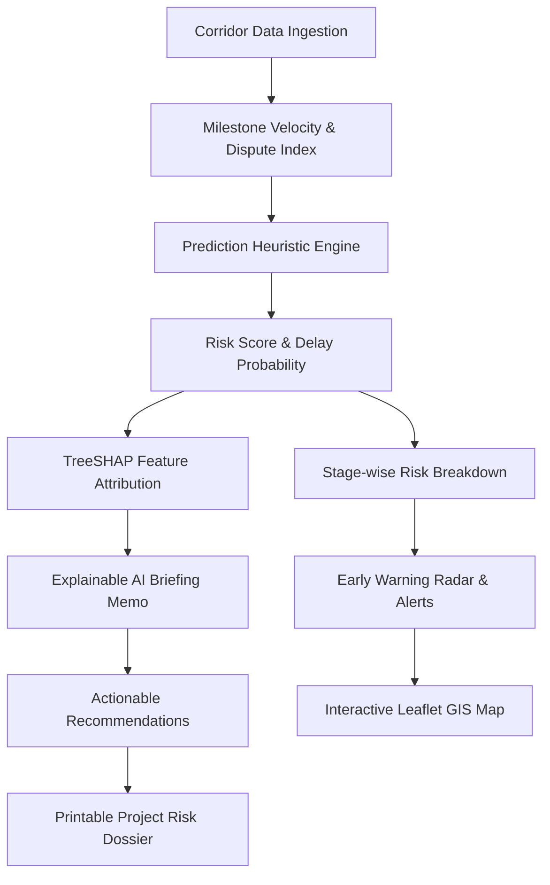

# LandPulse AI

### Predictive Analytics System for Early Detection of Land Acquisition Delays

> **"Predict Delays. Act Early. Deliver Projects Faster."**  
> *From Reactive Monitoring to Predictive Land Acquisition.*

[](https://www.sih.gov.in)
[](https://rural.gov.in)
[](https://dolr.gov.in)
[](https://react.dev)
[](https://www.typescriptlang.org)
[](https://expressjs.com)
[](https://tailwindcss.com)
[](https://leafletjs.com)
[](https://ai.google.dev)
[](LICENSE)

---

## 📌 Executive Summary

**LandPulse AI** is an AI-assisted decision-support platform designed to identify potential land acquisition delays early, explain the major risk factors, and provide actionable recommendations to project officials.

Developed as a prototype solution for **Smart India Hackathon 2026** under the **Ministry of Rural Development (Department of Land Resources - DoLR)**, LandPulse AI transforms land acquisition monitoring from a reactive checklist into a predictive, proactive early-warning system.

---

## 🎯 Problem Statement (SIH26017)

| Attribute | Details |
|---|---|
| **Problem Statement ID** | `SIH26017` |
| **Title** | Predictive Analytics System for Early Detection of Land Acquisition Delays |
| **Organization** | Ministry of Rural Development |
| **Department** | Department of Land Resources (DoLR) |
| **Theme** | Smart Automation |
| **Category** | Software |

### The Core Problem

Land acquisition under the **RFCTLARR Act, 2013** and the **National Highways Act, 1956** is the single most time-sensitive phase of national infrastructure delivery. Unforeseen delays stall highways, freight corridors, railway links, and energy parks, triggering contractual disputes and significant cost escalation.

Delays typically stem from:
- **Delayed compensation disbursements** (unverified bank accounts, KYC issues, indemnity bond backlogs)
- **Legal disputes** (High Court writ stay orders, market value reference appeals)
- **Prolonged administrative sanctions** (forest Stage-II clearances, inter-departmental utility shifts)
- **Incomplete documentation** (un-mutated joint ancestral records, missing Land Possession Certificates)
- **Rehabilitation and resettlement (R&R) impasses** (Gram Sabha grievances, colony site selection)
- **Possession & boundary handover bottlenecks** (encroachments, law-and-order coordination)

### The Structural Limitation

```text
TRADITIONAL REACTIVE MONITORING:
Milestone Lapses ──> Delay Becomes Severe ──> Contractors Claim Idling ──> Recovery Extremely Costly

LANDPULSE PREDICTIVE MONITORING:
Milestone Velocity ──> AI Risk Trajectory ──> Early Warning (3-6 mo early) ──> Proactive Corrective Camps
```

---

## 💡 The Solution

LandPulse AI provides an automated decision-support pipeline that ingests current milestone execution metrics, calculates delay probabilities across all statutory acquisition stages, explains root causes via feature attribution, and recommends targeted interventions.



---

## 🚀 Key Features

| Feature | Implementation Details |
|---|---|
| **National Project Dashboard** | High-level metrics tracking 128 infrastructure projects (14 High Risk, 27 Medium Risk, 87 On Track) with state-wise distributions. |
| **Featured Project Deep-Dive** | In-depth analysis of high-profile corridors such as the *Mumbai-Pune Infrastructure Corridor (`LA-MH-1024`)*. |
| **AI Risk Prediction Engine** | Calculates composite Risk Score (0–100), Delay Probability (%), Expected Delay (months), and Model Statistical Confidence. |
| **Statutory 6-Stage Milestone Tracker** | Visual milestone progression: *Notification &check; &rarr; Survey &check; &rarr; Documentation &check; &rarr; Compensation &#9888; &rarr; Possession &#9675; &rarr; Closure &#9675;*. |
| **Stage-wise Delay Probability** | Quantifies delay likelihood per phase (e.g., Notification: 12%, Survey: 18%, Documentation: 31%, Approval: 44%, Compensation: 78%). |
| **Top Delay Drivers (Explainable AI)** | Ranks bottleneck factors with TreeSHAP-style risk point contributions (e.g., Compensation Pending: +24 pts, Legal Disputes: +18 pts). |
| **Officer Briefing Generator** | Server-side Gemini 3.8 Flash integration generating concise, non-technical briefing memos for District Collectors and SLAOs. |
| **Recommended Corrective Actions** | Prioritized interventions categorized by authority (SLAO, Collector, High Court Pleader) and statutory provisions (RFCTLARR Sec 77, Sec 25). |
| **Planned vs. Actual Timeline** | Comparative variance tracking highlighting deviation days per statutory stage. |
| **Interactive Leaflet GIS Map** | Color-coded spatial markers across India (Critical Red, High Orange, Medium Amber, Low Green) with corridor popups and zoom focus. |
| **Alert Center & Risk Change Detection** | Flags significant threshold shifts (e.g., *64% &rarr; 82%, +18%*) with review tracking. |
| **Early Warning Radar** | Identifies corridors approaching statutory time-bar deadlines prior to formal breach. |
| **Contextual AI Assistant** | Grounded LandPulse chatbot powered by Gemini 3.8 Flash answering procedural and statutory queries. |
| **Printable Risk Dossier** | Formal Ministry-styled statutory project dossier with one-click print/PDF export. |
| **Guided SIH Demo Tour** | 6-step interactive guided walkthrough designed for hackathon evaluators. |

---

## 🔬 Risk Prediction & Explainability

### Sample Evaluation: Mumbai-Pune Infrastructure Corridor (`LA-MH-1024`)

```text
Corridor: Mumbai-Pune Infrastructure Corridor (LA-MH-1024)
Location: Pune, Maharashtra | Area: 840 Acres | Affected Families: 620
Current Stage: Compensation (Sec 23/31 Award Disbursement)

Risk Score:         82 / 100
Delay Probability:  78%
Risk Category:      HIGH
Expected Delay:     4.8 months
Model Confidence:   87% (Statistical model fit)
```

### Delay Attribution (Explainability)

Rather than outputting an opaque score, the system breaks down the prediction into interpretable risk point attributions:

| Rank | Delay Driver | Category | Impact | SHAP Contribution |
|---|---|---|---|---|
| **1** | Compensation Pending for Title Holders | Financial | HIGH | **+24 risk points** |
| **2** | Unresolved High Court Writ Petitions | Legal | HIGH | **+18 risk points** |
| **3** | Administrative Approval Bottleneck | Administrative | MEDIUM | **+12 risk points** |
| **4** | Land Records Discrepancy (7/12 Extract) | Documentation | MEDIUM | **+9 risk points** |
| **5** | Gram Sabha Rehabilitation Grievance | Social | LOW | **+5 risk points** |

---

## 🗺️ Geospatial GIS Visualization

The GIS module uses **Leaflet** to render geographic coordinates across India:

- 🔴 **Critical Risk (`> 80`)**: Pulsing red marker (e.g., *Bengaluru STRR Package 3 — LA-KA-5021*)
- 🟠 **High Risk (`60 – 79`)**: Orange marker (e.g., *Mumbai-Pune Corridor — LA-MH-1024*, *Eastern DFC Feeder Link — LA-UP-2031*)
- 🟡 **Medium Risk (`35 – 59`)**: Amber marker (e.g., *Delhi Multi-Modal Logistics Park — LA-DL-1088*)
- 🟢 **Low Risk (`< 35`)**: Emerald marker (e.g., *Bhadla-Phalodi Solar Park — LA-RJ-3042*)

---

## 🛠️ Technology Stack

```text
┌────────────────────────────────────────────────────────┐
│                   CLIENT (BROWSER)                     │
│  React 19 • TypeScript • Tailwind CSS v4 • Lucide Icons │
│  Leaflet GIS Map • Motion • Component Architecture      │
└───────────────────────────┬────────────────────────────┘
                            │ REST / JSON (Port 3000)
┌───────────────────────────▼────────────────────────────┐
│                    SERVER BACKEND                      │
│  Node.js • Express • tsx • In-Memory Datastore        │
│  Predictive Risk Engine • TreeSHAP Heuristic Parser    │
│  Vite Development Middleware Mount                     │
└───────────────────────────┬────────────────────────────┘
                            │ Server-Side Proxy (@google/genai)
┌───────────────────────────▼────────────────────────────┐
│                   AI INFERENCE TIER                    │
│  Google Gemini 3.8 Flash (Server-Only API Key)         │
│  Contextual SLAO Assistant • Explainable Memos         │
└────────────────────────────────────────────────────────┘
```

| Layer | Technologies Used |
|---|---|
| **Frontend Framework** | React 19, TypeScript |
| **Build Tooling** | Vite 8, `@vitejs/plugin-react` |
| **Styling & UI** | Tailwind CSS v4 (`@tailwindcss/vite`), CSS Variables |
| **Icons** | Lucide React |
| **GIS & Mapping** | Leaflet 1.9, `@types/leaflet` |
| **Backend Framework** | Node.js, Express 4.x, `tsx` |
| **AI Integration** | `@google/genai` (Gemini 3.8 Flash SDK) |
| **Environment Config** | `dotenv` |

---

## 📁 Repository Structure

```text
/
├── .env.example              # Environment variables template
├── .gitignore                # Git ignore patterns (node_modules, logs, secrets)
├── index.html                # HTML entry point with Leaflet styling
├── metadata.json             # AI Studio applet configuration & permissions
├── package.json              # Project scripts & dependencies
├── server.ts                 # Full-stack Express server & Gemini proxy routes
├── tsconfig.json             # TypeScript compiler settings
├── vite.config.ts            # Vite bundler configuration
└── src/
    ├── App.tsx               # Main application router & state controller
    ├── index.css             # Tailwind CSS & Leaflet map styling
    ├── main.tsx              # React DOM mounting entry point
    ├── components/
    │   ├── AlertCenterView.tsx     # Alert feed & risk variance tracker
    │   ├── AssistantModal.tsx      # Contextual Gemini SLAO assistant
    │   ├── DashboardView.tsx       # KPI overview & national risk metrics
    │   ├── EarlyWarningView.tsx    # Imminent statutory deadline alerts
    │   ├── GisMapView.tsx          # Interactive Leaflet geospatial map
    │   ├── LandingView.tsx         # Landing page & demo role selector
    │   ├── ModelInsightsView.tsx   # Model architecture & SHAP insights
    │   ├── Navbar.tsx              # Government header & tab navigation
    │   ├── ProjectDetailView.tsx   # Milestone timeline & risk deep-dive
    │   ├── ProjectsTable.tsx       # Filterable & sortable corridors table
    │   ├── ReportModal.tsx         # Printable project risk dossier
    │   └── SihDemoTourModal.tsx    # 6-step guided prototype tour
    ├── data/
    │   └── mockProjects.ts         # Realistic Indian land acquisition dataset
    ├── services/
    │   └── api.ts                  # Typed client-side REST API client
    └── types/
        └── index.ts                # TypeScript interfaces & domain models
```

---

## 🔌 API Endpoints (Implemented)

All endpoints are hosted on the Express backend (`server.ts`) at port `3000`:

| Method | Endpoint | Description |
|---|---|---|
| `POST` | `/api/auth/login` | Authenticates demo session as Government Official, Project Manager, or Administrator |
| `GET` | `/api/projects/risk-summary` | Aggregated national counts (total, high risk, medium risk, on track, state stats) |
| `GET` | `/api/projects` | Search, filter, and sort corridors across states, stages, and risk levels |
| `GET` | `/api/projects/:id` | Fetch complete profile and milestone history for a corridor |
| `POST` | `/api/projects/:id/predict` | Executes prediction engine heuristic and recalculates risk metrics |
| `GET` | `/api/projects/:id/factors` | Returns ranked TreeSHAP feature attributions and risk contributions |
| `GET` | `/api/projects/:id/recommendations` | Fetches prioritized corrective actions and legal references |
| `GET` | `/api/projects/:id/timeline` | Planned vs. actual days per statutory milestone |
| `GET` | `/api/gis/projects` | Returns GeoJSON FeatureCollection for Leaflet map markers |
| `GET` | `/api/alerts` | Active risk spike and statutory threshold alerts |
| `POST` | `/api/alerts/:id/review` | Marks a critical alert as reviewed by an official |
| `GET` | `/api/model/info` | Metadata on training sample volume, feature count, and calibration |
| `POST` | `/api/ai/assistant` | Contextual question-answering via Gemini 3.8 Flash (server-side) with fallback |
| `POST` | `/api/ai/explain` | Generates official administrative briefing memo using Gemini 3.8 Flash |
| `GET` | `/api/reports/:id` | Exports structured dossier payload for report generation |

---

## ⚙️ Getting Started

### Prerequisites

- **Node.js** (v18.x or v20.x recommended)
- **npm** or **bun**

### 1. Clone & Install Dependencies

```bash
git clone https://github.com/your-username/landpulse-ai.git
cd landpulse-ai
npm install
```

### 2. Configure Environment Variables

Create a `.env` file from `.env.example`:

```bash
cp .env.example .env
```

Edit `.env`:

```env
# Optional: Gemini API Key for dynamic LLM briefing notes and assistant
GEMINI_API_KEY="your-gemini-api-key"

# Application hosting URL (default: http://localhost:3000)
APP_URL="http://localhost:3000"
```

*(Note: If `GEMINI_API_KEY` is not provided, the application automatically uses the built-in heuristic reasoning fallback engine without crashing).*

### 3. Start the Development Server

```bash
npm run dev
```

Open your browser at **`http://localhost:3000`**.

### 4. Build for Production

```bash
npm run build
npm start
```

---

## 🚦 How to Run the SIH Demo

1. On the landing page, click **"Run Demo"** or click the blue **"RUN SIH DEMO"** button in the top navigation bar.
2. The interactive 6-step walkthrough will guide you through:
   - **Step 1:** Reviewing national dashboard KPIs (128 projects, 14 high risk).
   - **Step 2:** Selecting the **Mumbai-Pune Corridor (`LA-MH-1024`)** and noting the stalled Compensation stage.
   - **Step 3:** Executing the **AI Risk Analysis** button to generate the 78% delay probability and 4.8 months overrun estimate.
   - **Step 4:** Inspecting the **Top Delay Drivers (TreeSHAP)** and the official briefing memo.
   - **Step 5:** Opening the **GIS Map** to view color-coded spatial clusters.
   - **Step 6:** Reviewing the **Alert Center** (+18% risk increase) and generating the printable **Project Risk Dossier**.

---

## 🔮 Future Scope

The following features represent planned enhancements beyond the current hackathon prototype:

- **Bhoomi & State Revenue API Integration:** Live synchronization with state land mutation portals (e.g., MahaBhumi, UP Bhulekh, Karnataka Bhoomi).
- **Automated ML Pipeline Retraining:** Scheduled quarterly re-calibration with continuous drift detection as projects conclude.
- **Drone Orthophoto / Satellite Overlay:** Integration with PM GatiShakti GIS data layers to verify physical site clearances.
- **Automated SMS & WhatsApp Dispatch:** Direct automated notification of compensation verification camps to affected landholders.

---

## ⚖️ Important Disclaimer

> **SMART INDIA HACKATHON PROTOTYPE • SIMULATED DATA**  
> This software is an engineering prototype submitted for Smart India Hackathon 2026. Predictions, probabilities, risk scores, and recommended actions are statistical decision-support estimates generated using simulated historical data. They do not constitute official government forecasts and are not legally binding upon any Competent Authority, Special Land Acquisition Officer, or District Collector. All statutory determinations require official administrative review under applicable law.

---

## 📜 License

Distributed under the **Apache 2.0 License**. See `LICENSE` for details.
